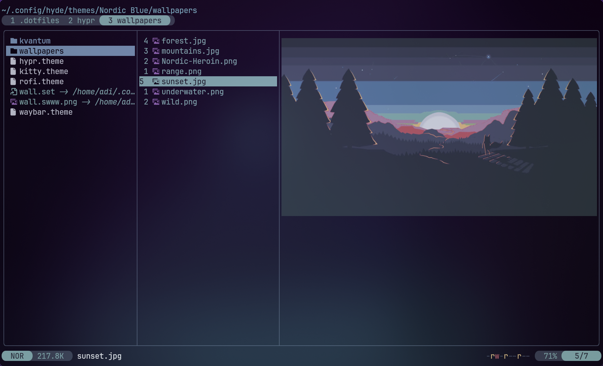

<!-- @format -->

<div align="center">
  
</div>

<h3 align="center">
 Nord Flavor for <a href="https://github.com/sxyazi/yazi">Yazi</a>
</h3>

# 👀 Preview



## 🎨 Installation

### For Latest Yazi Version

```sh
ya pkg add AdithyanA2005/nord
```

### For Yazi Version 25.5.28 and Earlier

```sh
ya pack -a AdithyanA2005/nord
```

## ⚙️ Usage

To set it as your dark flavor, change the content of your `theme.toml` to:

```toml
[flavor]
dark = "nord"
```

Make sure your `theme.toml` doesn't contain anything other than `[flavor]`, unless you want to override certain styles of this flavor.

See the [Yazi flavor documentation](https://yazi-rs.github.io/docs/flavors/overview) for more details.

## 📜 License

The flavor is MIT-licensed, and the included tmTheme is also MIT-licensed.

Check the [LICENSE](LICENSE) and [LICENSE-tmtheme](LICENSE-tmtheme) file for more details.
